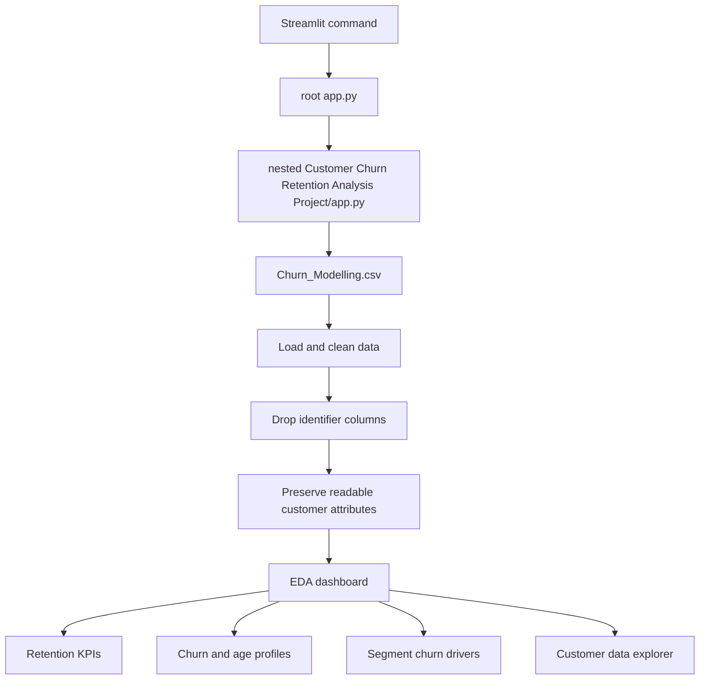

# Customer Churn & Retention Analysis
customerchurnretentionanalysis-app
.streamlit.app


Interactive customer churn analysis dashboard built with Python, Pandas, Seaborn, Matplotlib, and Streamlit.

## Project Architecture



## Directory Structure

```text
Customer Churn & Retention Analysis Project/
├── app.py                                  # Root Streamlit launcher
├── requirements.txt                         # Pinned Python dependencies
├── README.md                                # Project documentation
├── .venv/                                   # Local Python 3.11 environment (not committed)
└── Customer Churn Retention Analysis Project/
	├── app.py                              # Main dashboard implementation
	├── Churn_Modelling.csv                 # Customer churn dataset
	└── churn_model.ipynb                   # Exploratory analysis and optional model
```

## Application Flow

1. The root `app.py` forwards execution to the nested application file.
2. The dashboard loads `Churn_Modelling.csv` with Pandas.
3. `RowNumber`, `CustomerId`, and `Surname` are removed because they are identifiers, not useful analytical features.
4. The dashboard keeps customer attributes readable and excludes personal identifiers.
5. Sidebar filters update the metrics, visualizations, and data table together.
6. Customers can review and download the filtered data as a CSV.

The cleaned dataset is cached with `st.cache_data` so repeated Streamlit reruns do not reload the CSV unnecessarily.

## Dashboard Features

- Responsive dashboard with customer, churn, and retention KPIs
- Filters for region, age range, membership status, and product count
- Dataset-backed highlights for higher-churn age, region, and membership segments
- Retained-versus-churned split and age profile comparison
- Churn-rate comparisons by age group, region, membership, product count, gender, and balance status, with segment sample sizes
- Filtered customer data table with CSV download
- Source data quality checks and a descriptive-analysis caveat
- Personal identifiers excluded from the customer data view

## Setup

Create and activate the Python 3.11 environment from this project directory:

```powershell
py -3.11 -m venv .venv
.\.venv\Scripts\Activate.ps1
```

Install dependencies:

```powershell
python -m pip install -r requirements.txt
```

## Run the Dashboard

```powershell
python -m streamlit run app.py
```

Then open `http://localhost:8501` in a browser.

## Notebook

`churn_model.ipynb` contains the supporting analysis workflow:

- Data inspection and missing-value checks
- Churn, age, and geography analysis
- Correlation analysis
- Retention strategy visualizations
- Optional Logistic Regression experiment with a train-test split and classification report

The notebook loads the CSV from the project directory (or its nested application directory), rather than relying on a machine-specific absolute path. In the 10,000-row dataset, 2,037 customers have churned (20.37%); there are no missing values or duplicate rows. Germany has the highest regional churn rate (32.44%), customers aged 46–55 have the highest age-group rate (50.57%), and inactive members churn at 26.85%. These are descriptive associations, not causal findings. Smaller groups—especially customers with three or four products—should be interpreted with their sample sizes in mind.

The current Streamlit application is an EDA dashboard. It does not currently expose the notebook's Logistic Regression model as a live prediction endpoint or form.

## Dependencies

The pinned dependencies are listed in `requirements.txt`:

- Streamlit
- Pandas
- Seaborn
- Matplotlib

The notebook's optional modeling section also requires Scikit-learn.
